# A61 MessagIST Project Read Me

## Team

| Number  | Name              | User                              | E-mail                                          |
| --------|-------------------|-----------------------------------| ------------------------------------------------|
| 102611  | João Gouveia      | <https://github.com/joaotgouveia> | <mailto:joao.talone.gouveia@tecnico.ulisboa.pt> |
| 102606  | Rodrigo Arêde     | <https://github.com/rodasarede>   | <mailto:rodrigo.arede@tecnico.ulisboa.pt>       |
| 102604  | Gonçalo Rua       | <https://github.com/goncrust>     | <mailto:goncalonrua@tecnico.ulisboa.pt>         |


  

## Contents

This repository contains documentation and source code for the *Network and Computer Security (SIRS)* project.

The [REPORT](REPORT.md) document provides a detailed overview of the key technical decisions and various components of the implemented project.
It offers insights into the rationale behind these choices, the project's architecture, and the impact of these decisions on the overall functionality and performance of the system.

This document presents installation and demonstration instructions.

## Installation

To see the project in action, it is necessary to setup a virtual environment, with 2 networks and 5 machines.

The following diagram shows the networks and machines:

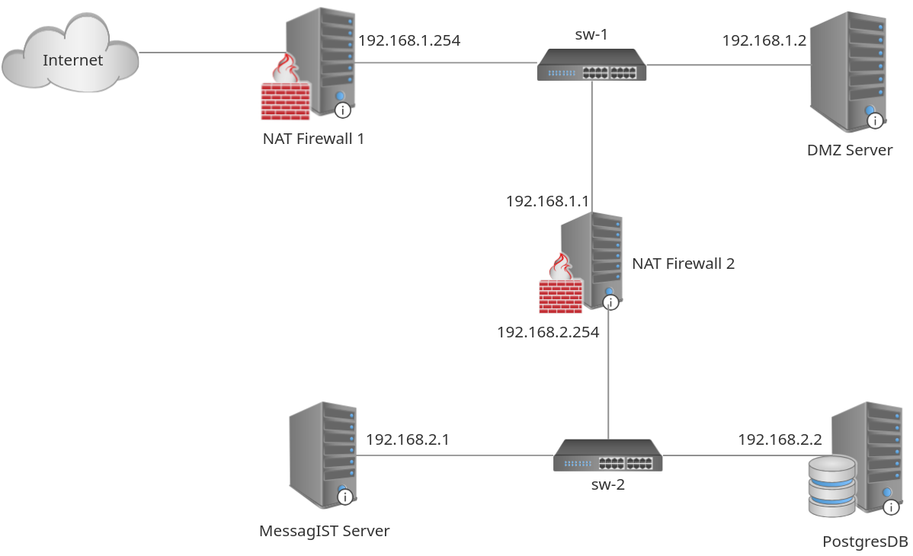

The `NAT Firewall 1` server connects to the internet with an IP address obtained via DHCP.

We also need to setup one more machine for the client. It needs to be able to connect to the internet to obtain the necessary requirements and to connect to the `NAT Firewall 1`'s external interface to interact with the server. It shouldn't be able to directly connect to any other internal network interfaces of the machines, effectively simulating a connection from the internet.

### Prerequisites

All the virtual machines are based on: `Ubuntu Server 24.04.1 LTS`, except for the client that runs `Ubuntu 24.04.1 LTS`.

[Download](https://ubuntu.com/download/server) and [install](https://ubuntu.com/tutorials/install-ubuntu-server#4-choose-your-language) a virtual machine of `Ubuntu Server 24.04.1 LTS`.

[Download](https://ubuntu.com/download/desktop) and [install](https://ubuntu.com/tutorials/install-ubuntu-desktop#5-installation-setup) a virtual machine of `Ubuntu 24.04.1 LTS`.

**Notes for the installation of Ubuntu Server**:
- The steps not specifically specified were left as default.
- In the step **Choose the type of installation**, choose the `Ubuntu Server` option (not `Ubuntu Server (minimized)`).
- In the step **Profile configuration**, we used the following configuration (choose another values as you which, keep in mind the rest of the guide uses these ones where needed):
  - **Your name**: (blank)
  - **Server's name**: ubuntuserver
  - **Userame**: serveradmin
  - **Password**: (choose a password)

Clone the `Ubuntu Server` machine to create four other machines.

### TLS Certificates

For convenience, TLS/SSL server certificates and private keys come pre-generated in this repo and are ready to use. If you want to generate new ones:

**Go to `messagist/publicserver/keys/` and type:**

Before generating the certificate, make sure to change the IP.2 in the **SAN** section of `publicserver_cert_config.cnf` to the external IP you are going to use for the `NAT Firewall 1`.

``` sh
$ openssl genpkey -algorithm RSA -out server.key -pkeyopt rsa_keygen_bits:2048
$ openssl req -new -x509 -key server.key -out server.crt -days 365 -config publicserver_cert_config.cnf
```

**Go to `messagist/database/keys/` and type:**

``` sh
$ openssl genpkey -algorithm RSA -out db_server.key -pkeyopt rsa_keygen_bits:2048
$ openssl req -new -x509 -key db_server.key -out db_server.crt -days 365 -config db_cert_config.cnf
```

**Go to `messagist/server/keys/` and type:**

``` sh
$ openssl genpkey -algorithm RSA -out server.key -pkeyopt rsa_keygen_bits:2048
$ openssl req -new -x509 -key server.key -out server.crt -days 365 -config server_cert_config.cnf
```

**Note 1:** obviously, the private keys of the servers shouldn't be on the other servers, nor the client. This is just a testing environment, and in a real world scenario the certificates and private keys should be generated independently in each server.

**Note 2:** since we didn't use a trusted CA to sign the certificates (self-signed certificates) we manually trust them in each server. Here is an example on how we did this for the connection between the **DMZ Server** and the **MessagIST Server** ([DmzMainClass.py:17](https://github.com/tecnico-sec/A61/blob/main/messagist/dmz/DmzMainClass.py#L16)):

``` python
server_cert = "../server/keys/server.crt"
with open(server_cert, "rb") as cert_file:
    trusted_certs = cert_file.read()
credentials = grpc.ssl_channel_credentials(root_certificates=trusted_certs)
self.ms_channel = grpc.secure_channel(
    main_server_ip + ":" + str(main_server_port), credentials
)
```

### Machine configurations

Inside each machine, use Git to obtain a copy of all the scripts and code.

```sh
$ git clone https://github.com/tecnico-sec/A61
```

Next we have custom instructions for each machine. Before continuing, turn off the VMs and setup the networks according to the diagram above. Again, make sure the `Client` machine can connect to the external interface of the `NAT Firewall 1` server. As an example using VirtualBox, the simplest way to do this is to create a `NAT Network` (File -> Tools -> Network Manager -> NAT Networks -> Create), and assign the external interface of `NAT Firewall 1` and the only interface of `Client` to the option `NAT Network`, and select the created NAT Network.

For each machine, there is an initialization script with the machine name, with prefix `init-` and suffix `.sh`, that installs all the necessary packages and makes all required configurations in the a clean machine.

**Note 1:** before running the initialization scripts, please change the necessary variables in the first lines as necessary, specially the network interfaces.

**Note 2:** please run the scripts from the cloned repo's root directory.

**Note 3:** the server scripts create a daemon that automatically setup the necessary configurations and run the server applications, so you don't need to do anything else after running them.

#### Machine 1 (NAT Firewall 1)

This machine runs the NAT firewall for the DMZ.

**First, run the initialization script:**

```sh
$ sudo ./config_scripts/init-natfirewall1.sh
```

**To verify:**

```sh
$ sudo systemctl status init-natfirewall1
```

Ensure the service is active. If not, enable and start it:

```sh
$ sudo systemctl enable init-natfirewall1
$ sudo systemctl start init-natfirewall1
```

#### Machine 2 (NAT Firewall 2)

This machine runs the NAT firewall for the internal network.

**First, run the initialization script:**

```sh
$ sudo ./config_scripts/init-natfirewall2.sh
```

**To verify:**

```sh
$ sudo systemctl status init-natfirewall2
```

Ensure the service is active. If not, enable and start it:

```sh
$ sudo systemctl enable init-natfirewall2
$ sudo systemctl start init-natfirewall2
```

#### Machine 3 (PostgresDB)

This machine runs the PostgreSQL database (version 16.6).

**First, run the initialization script:**

```sh
$ sudo ./config_scripts/init-postgresdbserver.sh
```

**To verify:**

```sh
$ sudo systemctl status init-postgresdbserver
```

Ensure the service is active. If not, enable and start it:

```sh
$ sudo systemctl enable init-postgresdbserver
$ sudo systemctl start init-postgresdbserver
```

#### Machine 4 (MessagIST Server)

This machine runs the main server of the application.
It runs a gRPC service for handling requests from the DMZ server and communicates with the PostgreSQL database.

**First, run the initialization script:**

```sh
$ sudo ./config_scripts/init-messagistserver.sh
```

**To verify:**

```sh
$ sudo systemctl status init-messagistserver
```

Ensure the service is active. If not, enable and start it:

```sh
$ sudo systemctl enable init-messagistserver
$ sudo systemctl start init-messagistserver
```

#### Machine 5 (DMZ Server, aka Public Server)

This machine runs the gRPC service to handle external requests to the MessagIST server.

**First, run the initialization script:**

```sh
$ sudo ./config_scripts/init-dmzserver.sh
```

**To verify:**

```sh
$ sudo systemctl status init-dmzserver
```

Ensure the service is active. If not, enable and start it:

```sh
$ sudo systemctl enable init-dmzserver
$ sudo systemctl start init-dmzserver
```

#### Machine 6 (Client)

This machine will be used to run the client and test the entire application.

**First, open a terminal and run the initialization script:**

```sh
$ sudo ./config_scripts/init-client.sh
```

**To test, restart the terminal, and run the client:**

```sh
$ cd messagist/client
$ conda activate messagist
$ python client.py -h [NAT Firewall 1 external IP]
```

If the application window doesn't start maximized, maximize it.

## Demonstration

Now that all networks and machines are up and running, let's take a tour of the best features of the application.

### 1. **Login Page**
When the application starts, it shows the login page to the user.

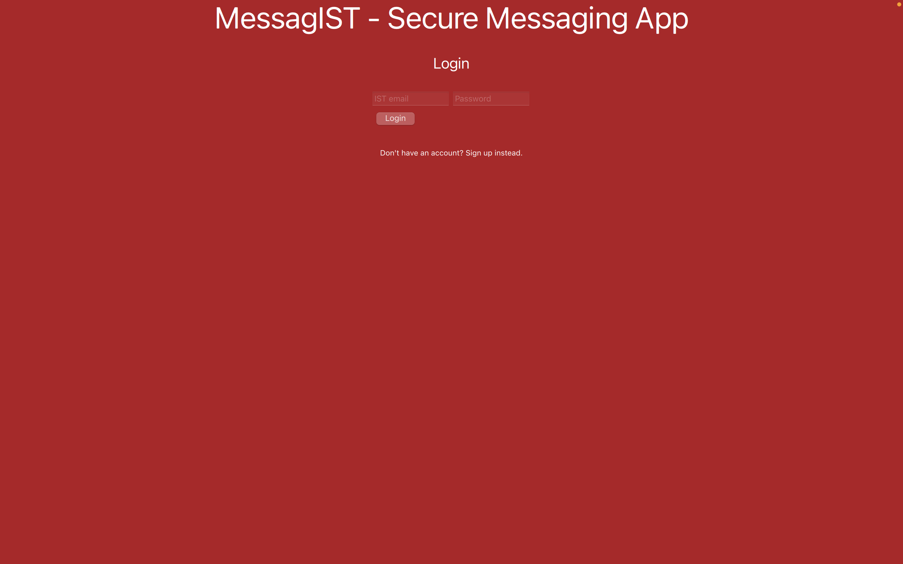

### 2. **Sign-Up Process**
As we don't have an account yet, we proceed to create a new one.

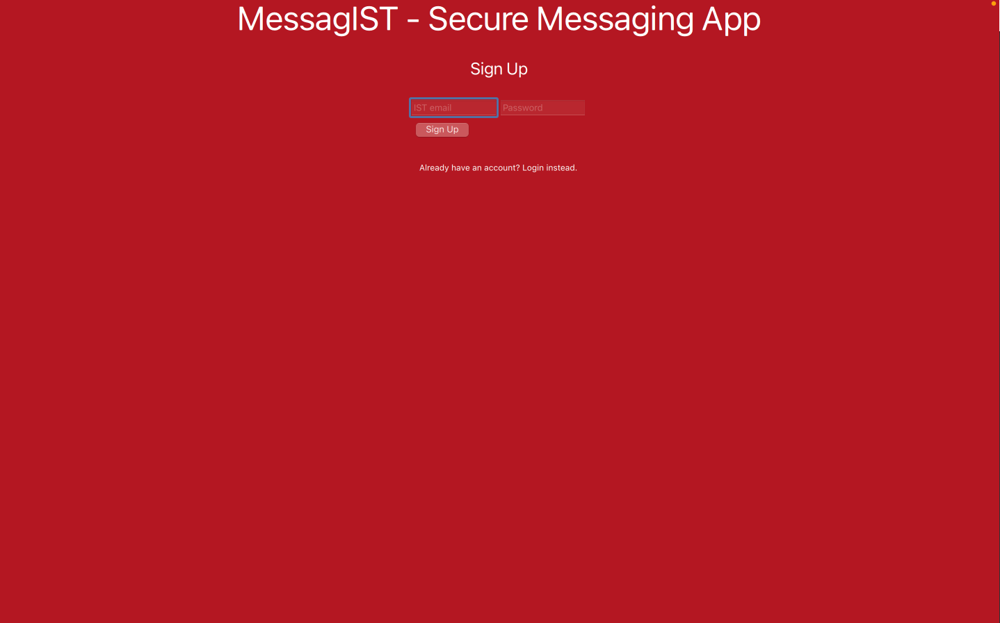

#### Attempt 1: Invalid Email Domain
We try to register with an email that doesn’t match the required domain (`tecnico`), and the registration fails.

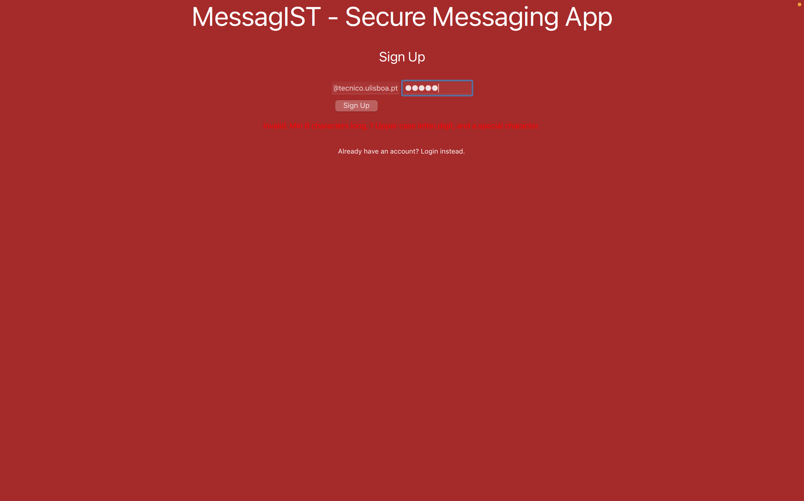

#### Attempt 2: Invalid Password
Next, we attempt to register with an invalid password format, which also fails.

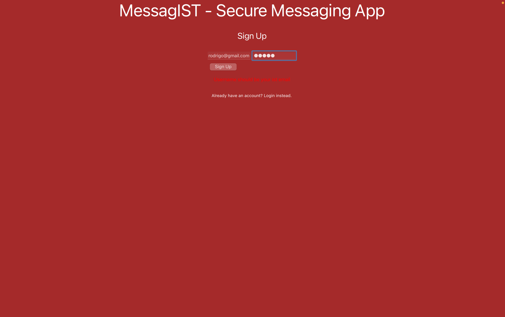

#### Successful Registration
Finally, we successfully create an account with a valid email and password. The application asks us to confirm our email to complete the sign-up process.

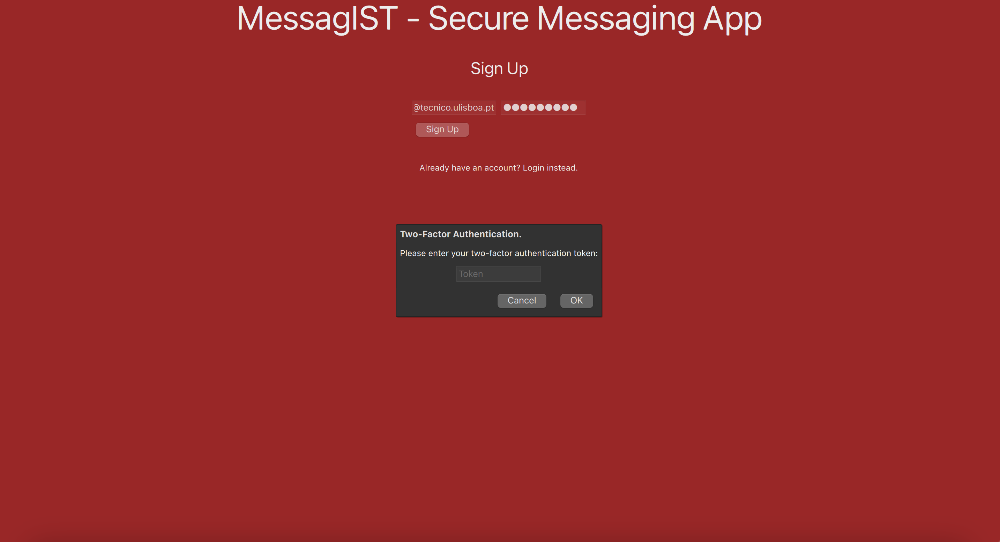

### 3. **Email Confirmation**
After confirming our email, we receive a word list for identity recovery.

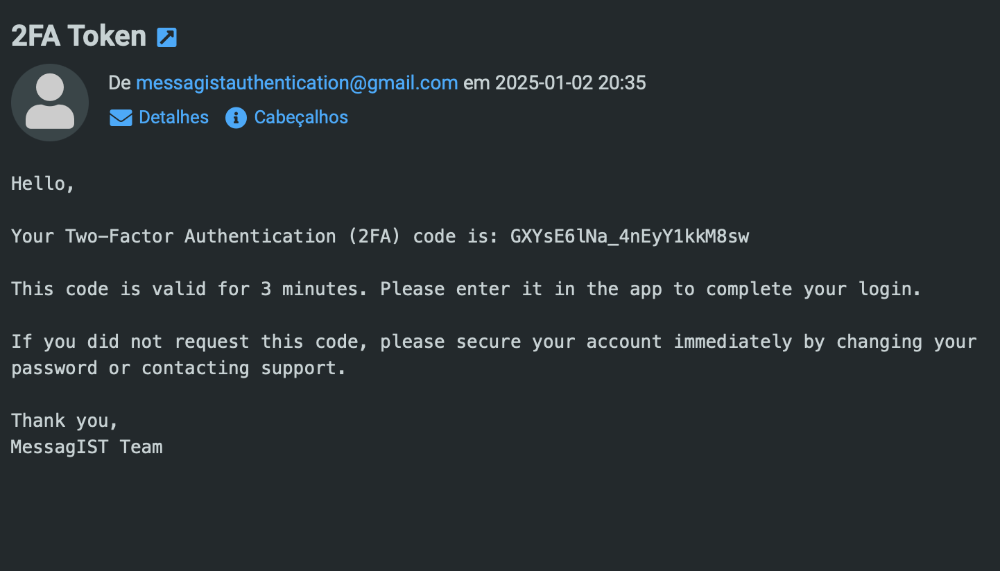
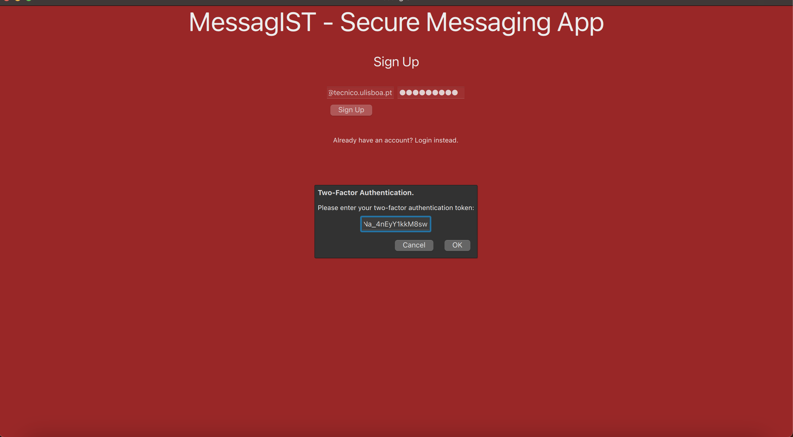

### 4. **Word List**
We recieve a word list that can recover our identity key  

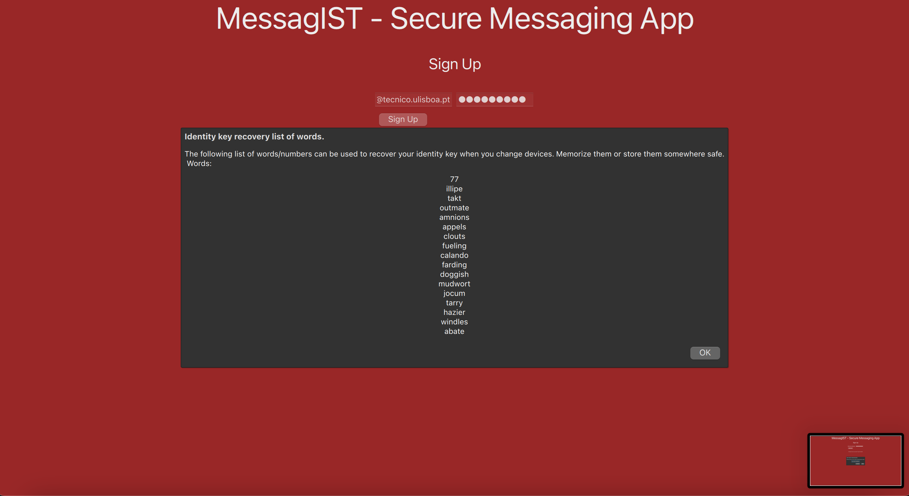

### 5. **Database Security**
As seen in the database, user information is stored with hashed passwords. If the database is compromised, attackers cannot access sensitive data like plaintext passwords.

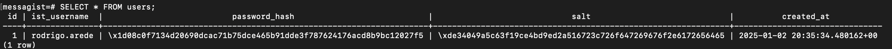

### 6. **Login Process**
We then proceed to log in.
The application prompts for two-factor authentication (2FA) to enhance security.

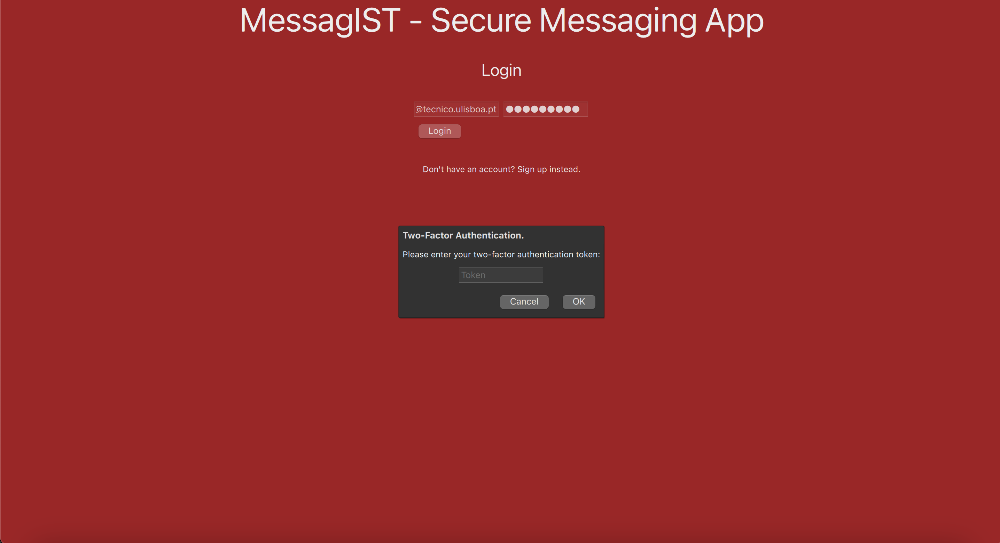

### 7. **Chat Creation and Messaging**
Now, I had created a new account named `anaritarosa` and logged in. The chat menu appears empty.


#### Creating a Chat
After creating a chat with the previously registered user `rodrigo.arede`, the application prompts for a chat password.

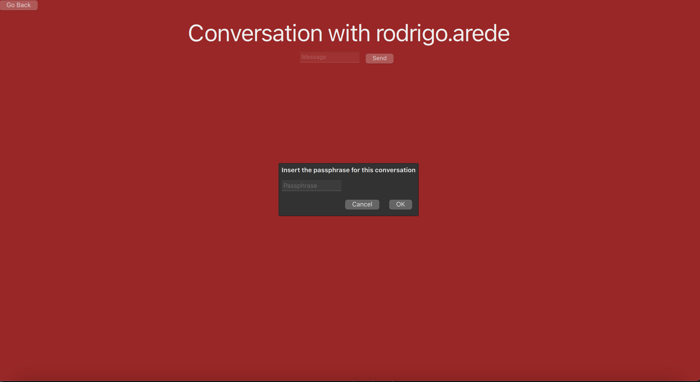

#### Sending Messages
I send two messages from `anaritarosa` to `rodrigo.arede`.

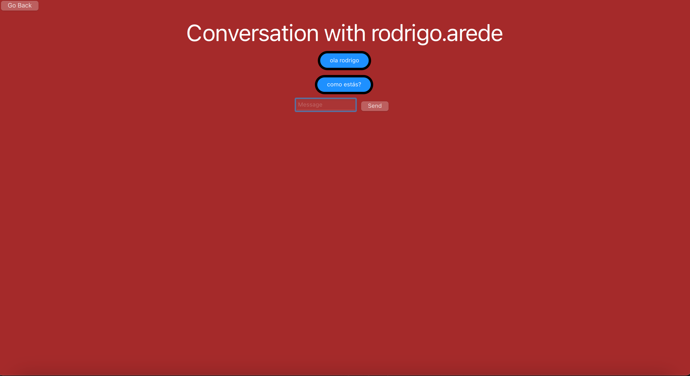

### 8. **Receiving Messages**
Switching to the `rodrigo.arede` account, I create a chat with `anaritarosa`. The chat password is required, and the messages from `anaritarosa` are received.

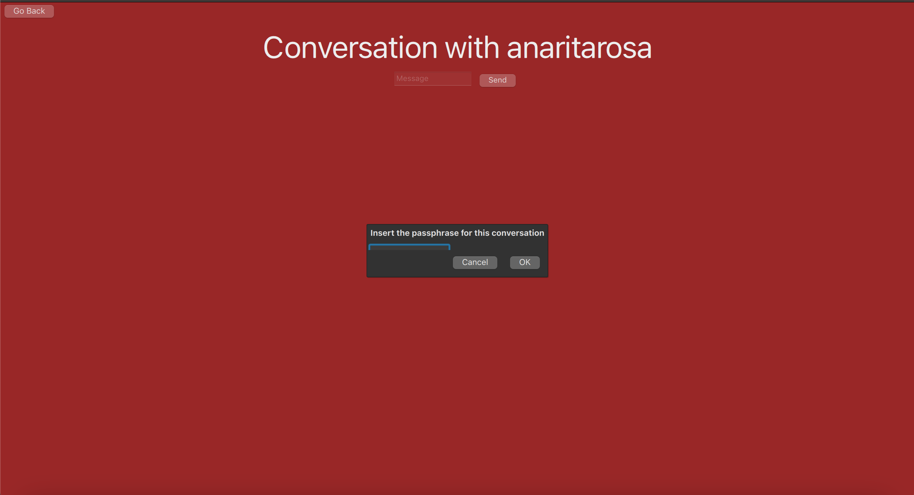
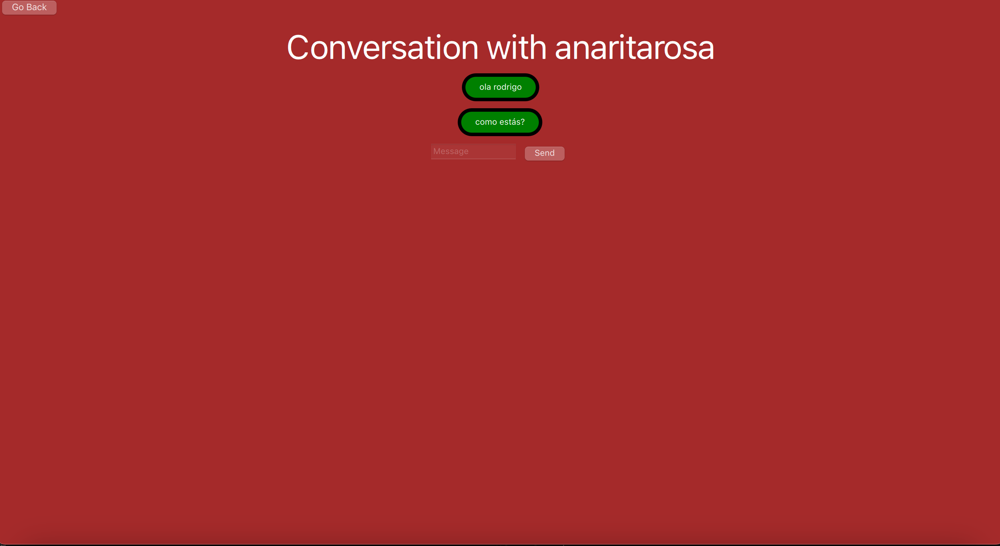

### 9. **Messaging Back**
I send messages from `rodrigo.arede` to `anaritarosa`, and switching back to `anaritarosa`, we can see that the messages are successfully received.

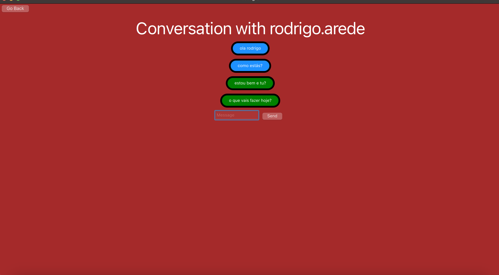
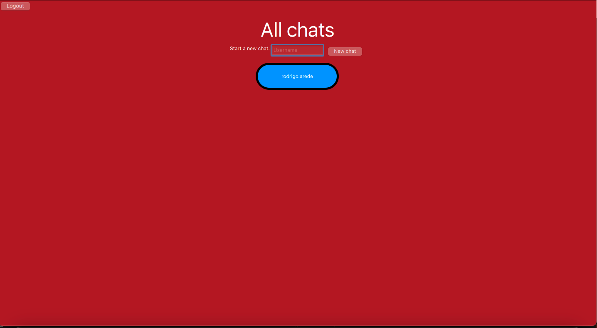

### 10. **Database Security**
As seen in the database, message information is safely stored. If the database is compromised, attackers cannot access sensitive data like plaintext messages.

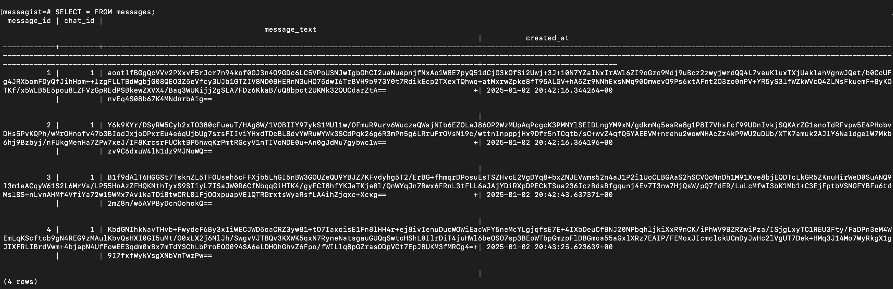
### 11. **Logging Out**
We attempt to log out of the application.


### 12. **Simulating Key Loss**
To simulate a key loss scenario, I remove the client key.

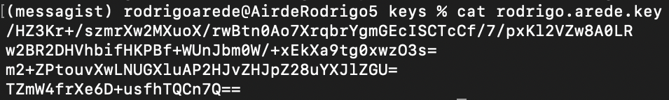


### 13. **Key Recovery**
We can recover the key by logging back in and entering the recovery words provided earlier.

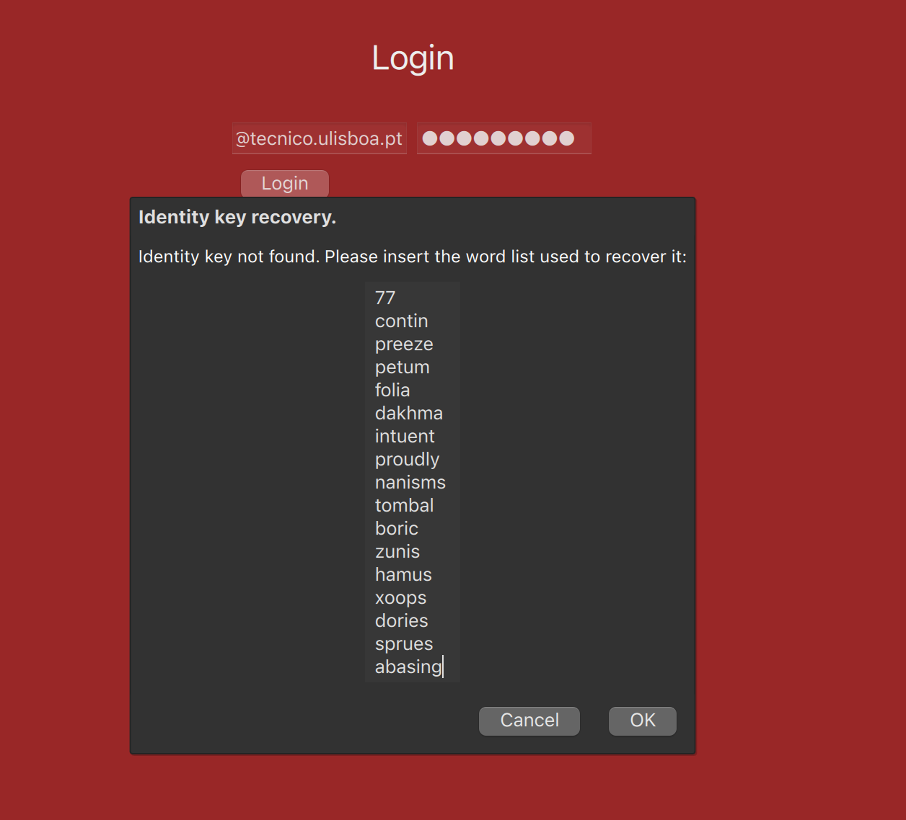

*(IMPORTANT: show evidence of the security mechanisms in action; show message payloads, print relevant messages, perform simulated attacks to show the defenses in action, etc.)*

This concludes the demonstration.

## Additional Information

### Links to Used Tools and Libraries
- [Python 3.12](https://www.python.org/)
- [grpcio 1.62.2](https://grpc.io/)
- [grpcio-tools 1.62.2](https://grpc.io/)
- [pyside 6.8.0](https://wiki.qt.io/Qt_for_Python)
- [cryptography 44.0.0](https://cryptography.io/en/latest/)
- [PostgreSQL 16.6](https://www.postgresql.org/)
- [psycopg 3.2.3](https://www.psycopg.org/)

### Versioning

We use [SemVer](http://semver.org/) for versioning.

### License

This project is licensed under the MIT License - see the [LICENSE.txt](LICENSE.txt) for details.

----
END OF README
